# EazyDiner Restaurant Data Analysis

**Exploratory Data Analysis (EDA) of restaurant listings collected from EazyDiner using Python, Web Scraping, Pandas, and Matplotlib.**

## 1. Project Overview

This project focuses on collecting, cleaning, analyzing, and visualizing restaurant listing data from the EazyDiner website across different Indian cities.

The dataset contains information about restaurant names, locations, cuisines, average cost for two people, ratings, and promotional offers.

The main objective is to identify patterns in restaurant availability, pricing, cuisines, ratings, and discounts through Exploratory Data Analysis (EDA).

**Note:** The findings represent restaurants included in the collected dataset, not all restaurants in India.

## 2. Project Objectives

- Identify cities and areas with the highest number of restaurant listings.
- Find the most frequently listed cuisines.
- Analyze restaurant pricing and cost distributions.
- Compare dining costs across cities and cuisines.
- Explore the relationship between restaurant prices and ratings.
- Identify areas with higher average restaurant ratings.
- Analyze the availability and types of promotional offers.

## 3. Technologies Used

| Technology | Purpose |
|---|---|
| Python | Data collection and analysis |
| Requests | Fetching restaurant listing pages |
| BeautifulSoup | Extracting information from HTML |
| Regular Expressions (Regex) | Extracting text patterns |
| JSON | Storing scraped restaurant data |
| Pandas | Data cleaning and analysis |
| NumPy | Numerical operations |
| Matplotlib | Data visualization |
| Jupyter Notebook | Running and documenting the project |

## 4. Dataset Information

**Data Source:** [EazyDiner](https://www.eazydiner.com/restaurants)

The dataset was collected using Python web scraping techniques. Restaurant details were extracted from listing pages across multiple cities.

### Dataset Features

| Column | Description |
|---|---|
| Restaurant_name | Name of the restaurant |
| Search_city | City used to search for restaurants |
| Area | Locality where the restaurant is listed |
| City | City extracted from restaurant information |
| Cuisines | Types of cuisines offered |
| Average_cost_for_two | Average dining cost for two people in INR |
| Rating | Restaurant rating on a scale of 0–5 |
| Offer_text | Available promotional offer description |

### Dataset Summary

| Metric | Value |
|---|---|
| Total Restaurant Records | [Enter count] |
| Total Cities | [Enter count] |
| Total Unique Cuisines | [Enter count] |
| Average Cost for Two | ₹[Enter amount] |
| Median Cost for Two | ₹[Enter amount] |
| Average Restaurant Rating | [Enter rating] / 5 |
| Restaurants With Recorded Offers | [Enter percentage]% |

## 5. Project Workflow

### Step 1: Data Collection

Restaurant data was collected from EazyDiner using Requests, BeautifulSoup, and Regular Expressions.

The scraper extracted restaurant names, locations, cuisines, costs, ratings, and promotional offers.

The collected data was stored in `eazydiner_restaurants.json`.

### Step 2: Data Cleaning

The scraped JSON data was converted into a Pandas DataFrame.

The cleaning process included:

- Checking the dataset dimensions and missing values.
- Filling missing city values using the search city.
- Removing Dubai and Abu Dhabi records for India-focused analysis.
- Standardizing column names.
- Replacing encoded characters in restaurant names.
- Inspecting missing cost and rating information.

The cleaned dataset was exported as `restaurants_india_cleaned.csv`.

### Step 3: Exploratory Data Analysis

EDA was performed using Pandas to identify patterns and relationships in restaurant listings.

The analysis focused on restaurant counts, cuisine availability, pricing, ratings, and offers.

### Step 4: Data Visualization

Matplotlib was used to create bar charts, histograms, box plots, scatter plots, and a pie chart to communicate the findings.

## 6. Exploratory Data Analysis and Visualizations

### 6.1 Top 10 Cities by Restaurant Count

**Objective:** Identify the cities with the highest number of restaurant listings.

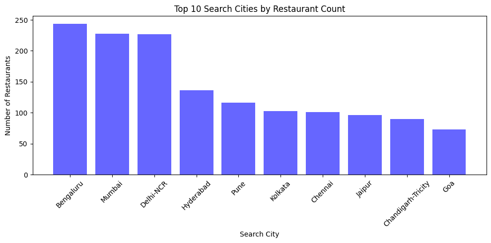

**Insight:**

- **Bengaluru** has the highest number of restaurant listings with **244 restaurants**.
- Mumbai (228) and Delhi-NCR (227) follow closely, while Hyderabad (136) and Pune (116) complete the top five.
- Bengaluru, Mumbai, and Delhi-NCR are the most represented cities in the collected dataset.

### 6.2 Top 10 Most Frequently Listed Cuisines

**Objective:** Identify the cuisines most commonly available among the listed restaurants.

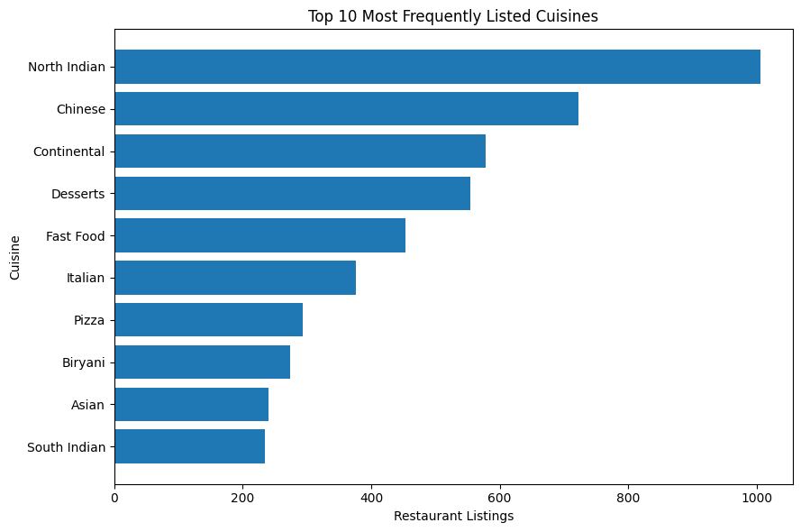

**Insight:**

- **North Indian** is the most frequently listed cuisine, appearing in **1,006 restaurant listings**.
- Chinese (723), Continental (578), and Desserts (554) are also widely represented.
- Restaurants may serve multiple cuisines, so cuisine counts can overlap.

### 6.3 Restaurant Cost Distribution

**Objective:** Understand the distribution of average dining costs for two people.

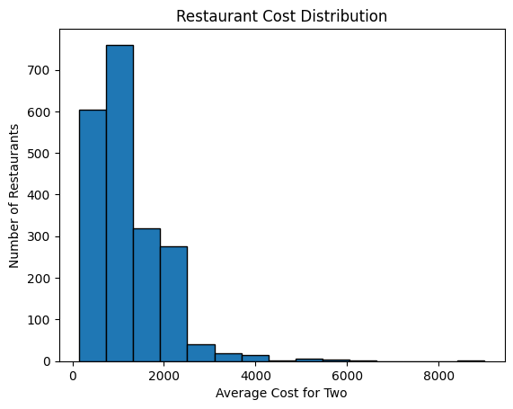

**Insight:**

- The average dining cost for two people is approximately **₹1,207**, while the median is **₹1,000**.
- The middle 50% of restaurant costs fall between **₹600 and ₹1,500**.
- Dining costs range from ₹150 to ₹9,000, indicating considerable price variation and some expensive outliers.

### 6.4 Top 10 Most Expensive Restaurants

**Objective:** Identify restaurant listings with the highest average dining costs.

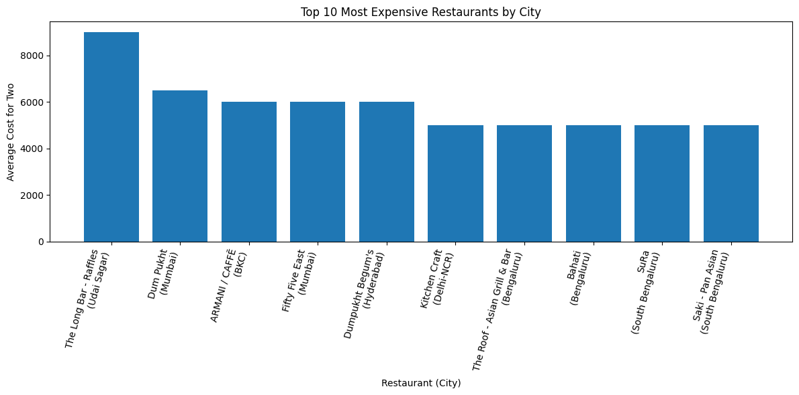

**Insight:**

- **The Long Bar - Raffles in Udaipur** has the highest recorded cost for two at **₹9,000**.
- Dum Pukht in Mumbai follows at ₹6,500.
- ARMANI / CAFFĒ and Fifty Five East in Mumbai, along with Dumpukht Begum's in Hyderabad, have listed costs of ₹6,000 for two people.

### 6.5 Restaurant Rating Distribution

**Objective:** Understand how restaurant ratings are distributed.

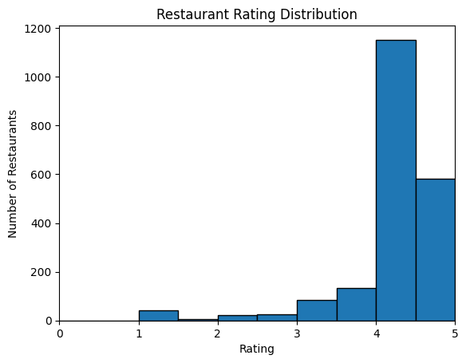

**Insight:**

- The average restaurant rating is approximately **4.12/5**, with a median rating of 4.0.
- The middle 50% of recorded ratings fall between **4.0 and 4.5**.
- All **2,046 restaurant records** contain a rating value, with ratings ranging from 1.0 to 5.0.

**Note:** Rating values should be validated against a sample of original listings to confirm extraction accuracy.

### 6.6 Restaurant Cost Comparison Across Cities

**Objective:** Compare dining costs across the five cities with the most restaurant listings.

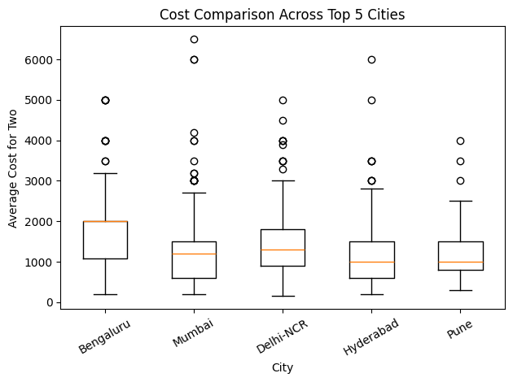

**Insight:**

- **Bengaluru** has the highest median restaurant cost at **₹2,000 for two people**.
- Delhi-NCR (₹1,300) and Mumbai (₹1,200) follow, while Hyderabad and Pune both have a median cost of ₹1,000.
- Mumbai and Hyderabad contain particularly expensive listings, reaching ₹6,500 and ₹6,000 respectively.

### 6.7 Restaurant Cost vs Rating

**Objective:** Investigate whether more expensive restaurants tend to receive higher ratings.

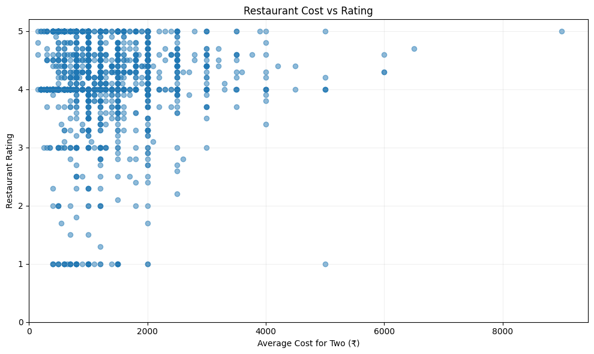

**Insight:**

- The correlation coefficient between restaurant cost and rating is approximately **0.057**.
- This indicates a **very weak positive linear relationship** between dining cost and restaurant rating.
- Higher-priced restaurants do not consistently receive higher ratings in the collected dataset.

**Interpretation:** Restaurant price alone is not a reliable indicator of its rating.

### 6.8 Restaurants With and Without Recorded Offers

**Objective:** Determine the percentage of restaurant listings containing promotional offers.

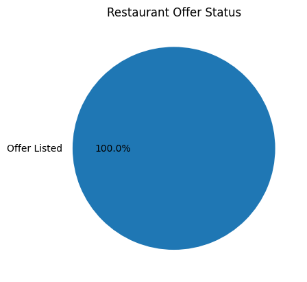

**Insight:**

- All **2,046 restaurant listings (100%)** contain a recorded promotional offer description.
- No listings were identified without offer information.
- Promotional offers are consistently represented in the collected dataset.

**Note:** This finding reflects the scraped records and does not confirm whether every promotion is currently available or applicable.

### 6.9 Top 10 Cities by Median Restaurant Cost

**Objective:** Identify cities with the highest typical dining costs.

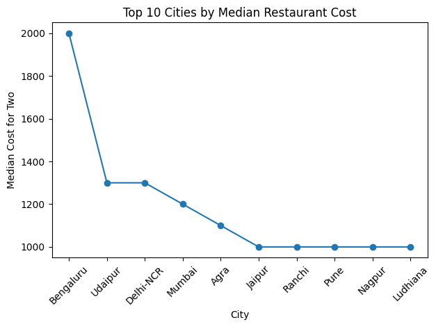

**Insight:**

- **Bengaluru** has the highest median dining cost at **₹2,000 for two people**.
- Udaipur and Delhi-NCR follow at ₹1,300, while Mumbai has a median cost of ₹1,200.
- Median cost provides a useful comparison of typical dining prices while reducing the influence of extreme values.

### 6.10 Top 10 Areas by Restaurant Count

**Objective:** Identify areas with the highest number of restaurant listings.

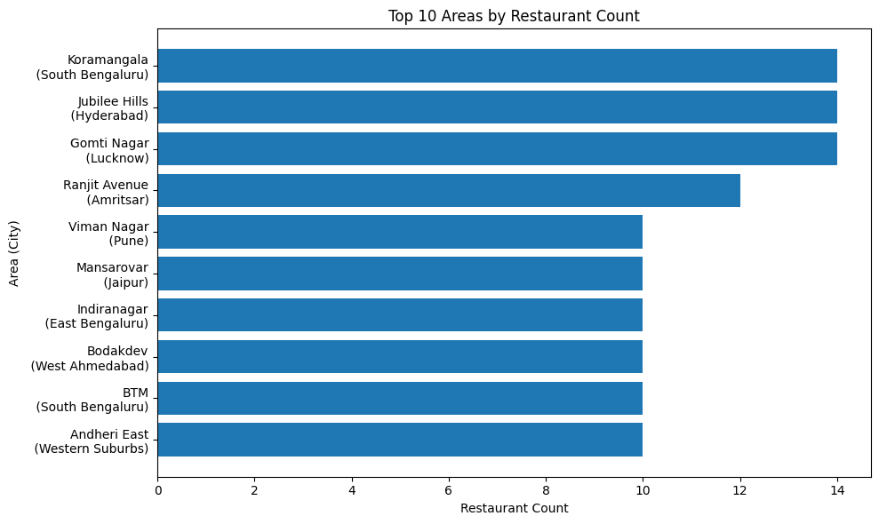

**Insight:**

- **Jubilee Hills (Hyderabad), Gomti Nagar (Lucknow), and Koramangala (Bengaluru)** share the highest restaurant count, with **14 listings each**.
- Ranjit Avenue in Amritsar follows with 12 restaurant listings.
- Viman Nagar, Indiranagar, and Andheri East are among several areas containing 10 listings each.

### 6.11 Most Common Restaurant Offers

**Objective:** Identify the most frequently advertised promotional offers.

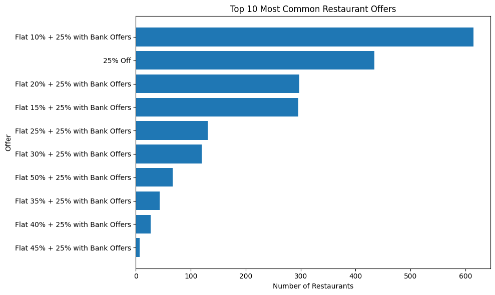

**Insight:**

- **Flat 10% + 25% with Bank Offers** is the most frequently recorded promotion, appearing in **615 listings**.
- The next most common offer is **25% Off**, appearing in 434 listings.
- Offers combining flat discounts with bank promotions are common throughout the dataset.

**Note:** The advertised discount percentages may be subject to separate conditions and should not automatically be added together.

### 6.12 Top 10 Highest-Rated Restaurant Areas

**Objective:** Identify areas with the highest average restaurant ratings while considering the number of rated restaurants.

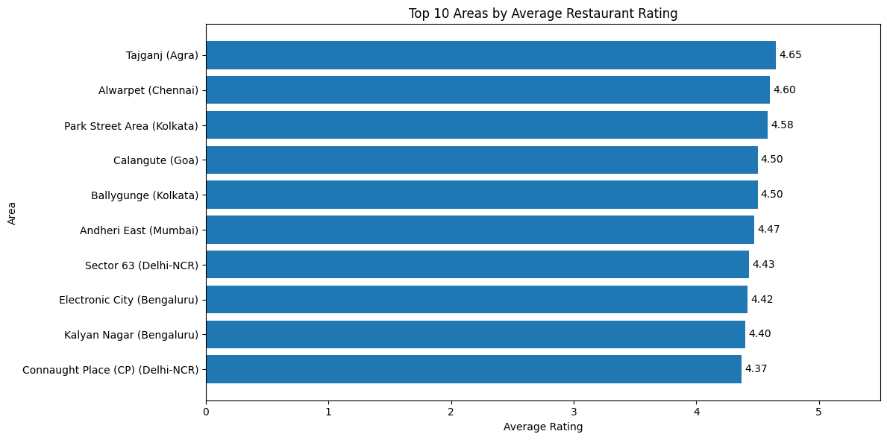

**Methodology:**

- Group restaurants by `Search_city` and `Area`.
- Calculate the average rating for each area.
- Count the number of restaurants with valid ratings.
- Consider only areas having at least **5 rated restaurants**.
- Select the top 10 areas based on average rating.

This minimum-count condition helps avoid ranking an area highly based on only one or two restaurant ratings.

**Insight:**

- **Tajganj in Agra** has the highest average restaurant rating of **4.65/5**, based on 6 rated restaurants.
- Alwarpet in Chennai follows with 4.60/5 from 5 restaurants, while Park Street Area in Kolkata has 4.58/5 from 5 restaurants.
- Andheri East in Mumbai has an average rating of 4.47/5 across 10 restaurants, representing a comparatively larger sample among the highest-rated areas.

**Interpretation:** Considering both average ratings and the number of rated restaurants provides a more meaningful area-wise comparison.


### 6.13 Top 10 Cuisines by Average Restaurant Cost

**Objective:** Identify cuisines associated with higher average dining costs while considering the number of restaurant listings in each cuisine category.

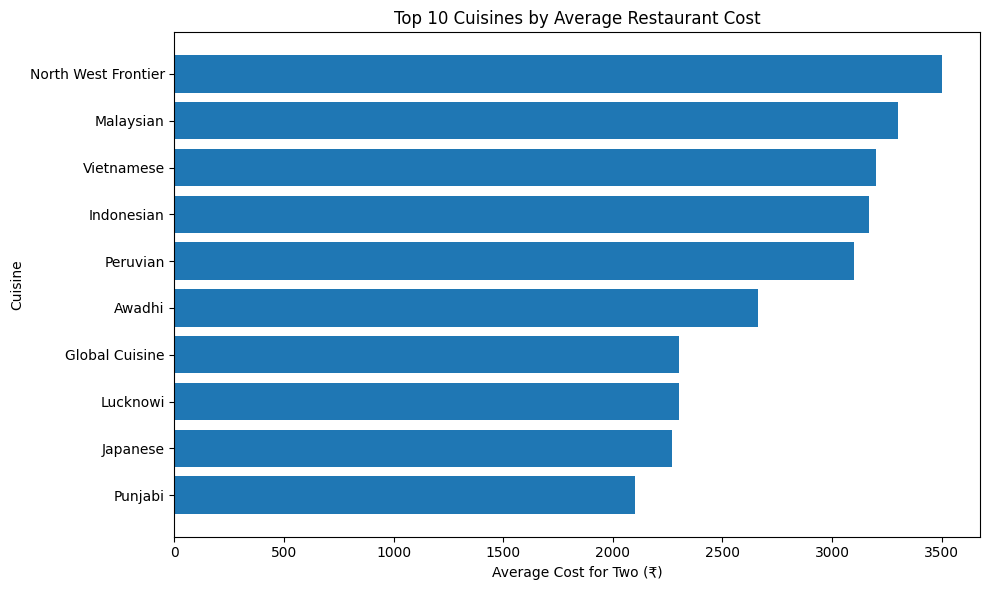

**Methodology:**

- Group restaurant listings by cuisine.
- Calculate the average dining cost for two people for each cuisine.
- Count the number of restaurants with valid cost information.
- Consider only cuisines having at least **10 valid restaurant cost records**.
- Select the top 10 cuisines based on average dining cost.

This minimum-count condition helps avoid ranking cuisines based on very small samples.

**Insight:**

- **Japanese cuisine** has the highest average dining cost at approximately **₹2,272 for two people**, based on 54 restaurant listings.
- **Middle Eastern (₹2,082)** and **Mediterranean (₹2,007)** follow, with 11 and 28 restaurant listings respectively.
- Thai (₹1,873) and Modern Indian (₹1,765) are also among the higher-priced cuisines in the filtered dataset.

**Interpretation:** Average dining costs vary across cuisine categories. However, these differences may also reflect restaurant type, location, and other factors beyond cuisine alone.


## 7. Key Findings and Insights

| Analysis | Key Finding |
|---|---|
| Total Restaurant Records | 2,046 |
| Highest Restaurant Count | Bengaluru — 244 restaurants |
| Most Common Cuisine | North Indian — 1,006 listings |
| Average Dining Cost | ₹1,207 for two |
| Median Dining Cost | ₹1,000 for two |
| Most Expensive Restaurant | The Long Bar - Raffles, Udaipur — ₹9,000 |
| Average Restaurant Rating | 4.12/5 |
| Middle 50% Rating Range | 4.0–4.5 |
| Highest Median-Cost City | Bengaluru — ₹2,000 |
| Areas With Most Listings | Jubilee Hills, Gomti Nagar, Koramangala — 14 each |
| Highest-Rated Eligible Area | Tajganj, Agra — 4.65/5 from 6 rated restaurants |
| Restaurants With Recorded Offers | 100% |
| Most Common Offer | Flat 10% + 25% with Bank Offers — 615 listings |
| Cost vs Rating Relationship | Very weak positive correlation (0.057) |

## 8. Challenges and Limitations

### Challenges

- Extracting restaurant information from complex HTML structures.
- Handling missing and inconsistent restaurant information.
- Separating area and city names from location strings.
- Extracting ratings from SVG elements without capturing unrelated numerical values.
- Cleaning encoded characters in restaurant names.
- Processing restaurants that serve multiple cuisines.
- Comparing average ratings and costs when groups have different numbers of restaurants.

### Limitations

- The dataset includes only restaurant listings collected from EazyDiner.
- The collected data may not represent all restaurants in a city or across India.
- Restaurant ratings, prices, and promotional offers may change over time.
- Some information may be missing or incorrectly extracted due to website structure changes.
- Multiple listings may refer to the same restaurant.
- Area-wise average ratings may be affected by sample size, even after applying the minimum five-rating threshold.
- Some cuisine categories contain very few restaurant listings, making their average costs less reliable.
- Recorded promotional offers may not reflect their current availability or eligibility conditions.
- The analysis does not directly measure customer preferences, actual restaurant quality, or causal relationships.

## 9. Conclusion

This project demonstrates an end-to-end data analysis workflow, starting from web scraping and data collection to data cleaning, exploratory analysis, and visualization.

The analysis of **2,046 restaurant listings** shows that Bengaluru has the highest number of collected restaurant listings and the highest median dining cost. North Indian and Chinese are the most frequently listed cuisines, while the overall median dining cost is ₹1,000 for two people.

Restaurant ratings are generally concentrated between 4.0 and 4.5, and the very weak correlation between dining cost and rating suggests that higher prices are not consistently associated with better ratings.

Area-wise analysis identifies Tajganj in Agra as the highest-rated eligible area, while promotional offer descriptions appear in every collected listing.

Overall, the project demonstrates practical skills in **Python, BeautifulSoup, Pandas, data cleaning, exploratory data analysis, and Matplotlib**, along with the ability to interpret and communicate findings from real-world web data.


## 10. Project Structure

```text
EazyDiner-Restaurant-Analysis/
│
├── Data/
│   ├── Data_Original.json
│   ├── eazydiner_restaurants.json
│   └── restaurants_india_cleaned.csv
│
├── images/
│   ├── 01_city_counts.png
│   ├── 02_popular_cuisines.png
│   ├── 03_cost_distribution.png
│   ├── 04_expensive_restaurants.png
│   ├── 05_rating_distribution.png
│   ├── 06_city_cost_boxplot.png
│   ├── 07_cost_vs_rating.png
│   ├── 08_offer_status.png
│   ├── 09_median_cost_by_city.png
│   ├── 10_area_counts.png
│   ├── 11_common_offers.png
│   ├── 12_area_average_rating.png
│   └── 13_cuisine_average_cost.png
│
├── main.ipynb
└── README.md
```

## 11. How to Run the Project

**Step 1: Clone the repository**

```bash
git clone https://github.com/YOUR_USERNAME/EazyDiner-Restaurant-Analysis.git
```

**Step 2: Navigate to the project folder**

```bash
cd EazyDiner-Restaurant-Analysis
```

**Step 3: Install required libraries**

```bash
pip install -r requirements.txt
```

**Step 4: Open the notebook**

```bash
jupyter notebook main.ipynb
```

Run the notebook cells in order to explore the data and reproduce the analysis.

The notebook can use the included scraped JSON dataset without repeating the web scraping process.

## 12. Future Improvements

- Improve web scraping reliability and error handling.
- Validate rating extraction against original restaurant listings.
- Detect and remove confirmed duplicate records.
- Analyze discounts in more detail.
- Compare restaurant ratings using different minimum sample sizes.
- Build an interactive dashboard using Power BI or Plotly.
- Study changes in restaurant pricing and ratings over time.

---

**Project Type:** Python Web Scraping and Exploratory Data Analysis

**Data Source:** [EazyDiner](https://www.eazydiner.com/restaurants)

**Author:** Kurmala Chenchu Baba Manikanta